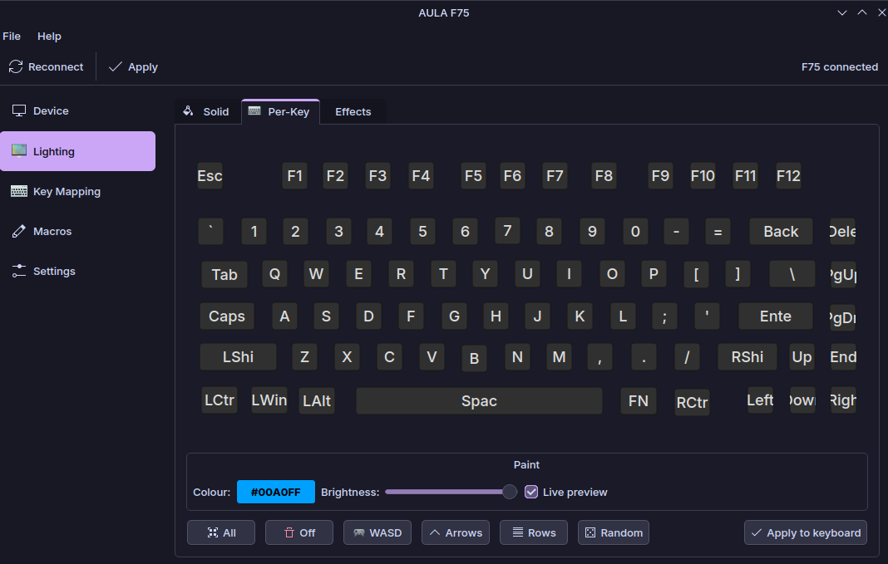

# LLM Disclaimer
This was made entirely by DeepSeek v4.1 Flash, I have not written a single line of code (besides the nix flakes, most of this README, and just giving it the right prompts), if you do not want like projects made by LLMs, that is absolutely fine, and you can ignore this. However, that does not mean I will stop maintaining this project, I am simply trying to make life easier for Linux users with this keyboard, and I am not necessarily someone who doesn't
understand code!

# AULA F75 for Linux

A native Linux/KDE configurator for the **AULA F75** mechanical keyboard.

The F75 only ever shipped a Windows driver (`OemDrv.exe`), which talks to the
keyboard over a vendor HID collection. This project speaks that protocol
directly from Linux.

<p align="center">
  
</p>

## Features

Just about anything you'd find in the original proprietary app.

## Requirements

- Linux with `hidraw` (any modern desktop / kernel).
- For the NixOS module: NixOS with flakes.
- A user in the `input` group, or the supplied udev rule.

## Install (NixOS, flakes)

```nix
# flake.nix
inputs.aula-f75.url = "github:sidharthify/Aula-F75-Linux";
```

```nix
# configuration.nix
{
  imports = [ inputs.aula-f75.nixosModules.default ];

  programs.aula-f75.enable = true;
}
```

The module installs the application, the desktop entry and a udev rule that
gives the `input` group access to the keyboard's config interface
(`258a:010c` wired, `3554:fa09` wireless receiver).

## Install (without the module)

```nix
# configuration.nix
environment.systemPackages = [
  inputs.aula-f75.packages.x86_64-linux.default
];

services.udev.extraRules = ''
  SUBSYSTEM=="hidraw", ATTRS{idVendor}=="258a", ATTRS{idProduct}=="010c", GROUP="input", MODE="0660"
  SUBSYSTEM=="hidraw", ATTRS{idVendor}=="3554", ATTRS{idProduct}=="fa09", GROUP="input", MODE="0660"
'';
```

## Build from source

```sh
nix build
# or
cmake -S . -B build -G Ninja -DCMAKE_BUILD_TYPE=Release
cmake --build build
```

## How it works

The keyboard exposes a vendor HID collection (Usage Page `0xFF02`, Usage
`0x0002`, Report ID `0x13`). Every command is a 20 byte output report:

```
13 <opcode> <chunks> <index> <(type<<4)|len> <payload…> <crc>
```

`crc` is the 8-bit sum of the first 19 bytes. Replies use the same framing.
Because the F75 drops out of *direct* colour mode when it stops being talked
to, the current frame is re-sent every 50 ms while the app is running. The full
protocol is documented in [PROTOCOL.md](PROTOCOL.md).

## Legal

This is an independent, clean-room interoperability project. It contains no
code or assets from the AULA driver. The protocol was recovered by examining
the shipped binary and the keyboard's HID descriptors. Use at your own risk.

## Licence

GPL-3.0-or-later. See [LICENSE](LICENSE).
